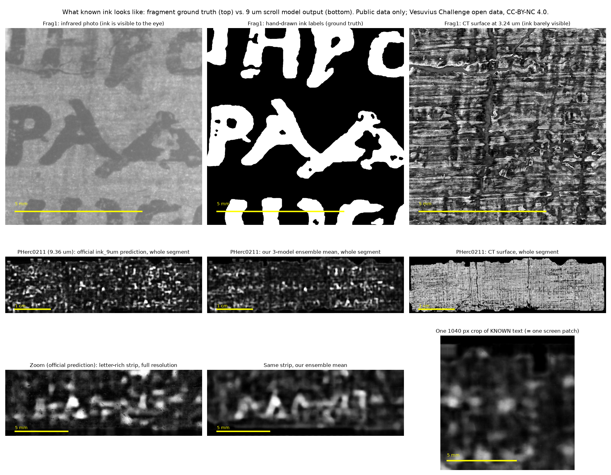

# Vesuvius First Letters pipeline on a single Windows workstation (WSL2)

This repo is a reproducible, scripted run of the First Letters workflow on an eligible scroll, on one Windows workstation running WSL2 Ubuntu. It goes from public CT data to rendered surfaces, zero-shot ink inference and an image-free whole-scroll screen. The workflow it follows is "From CT Scan to Ancient Text: A First Letters Prize Workflow" (Vesuvius Challenge, Aug 2026).

The target scroll is **PHerc0125**, volume 20250821151825 (9.362 µm, 113 keV, ESRF BM18).

No text recovery is claimed.

## Summary of results

| Step | Result |
|---|---|
| Inference wrapper vs official `ink_9um` output | Pearson r = 1.000 on a PHerc0800 segment and on the PHerc0211 First Letters winning segment |
| Spiral fit, minimal constraints, z 10300–11200 | 3,000 steps in 11–21 min, 20,000 steps in 32 min on one 48 GB GPU. Rendered windings score at chance on surface quality. |
| Spiral sense (catalog value is null) | Overall sign points to CW (+0.075, 95% CI +0.047 to +0.100), but one z sub-band reverses, so it is unresolved |
| Seed-grown patches on the surface-prediction volume | 51–56% of tiles on-sheet |
| Whole-scroll screen, 122 patches at z = 10750 | 27 min total, about 13 s per patch. 17 patches pass the surface filters. |
| Zero-shot ink response | Median patch score 0.8, where known text = 1.0 and blank ≈ 0.2. The model responds broadly on this scroll, and a visual review of the top-ranked patches found no legible text. |
| Per-pixel layer alignment (`refine_surface.py`) | On the 15 best PHerc0125 patches, on-sheet tiles rose from 41–81% to 64–91%, but sharpness stayed at 0.04–0.09. On the PHerc0211 winning segment, sharpness rose from 0.12 to 0.16 and the ink signal was unchanged (23.3 components per Mpx before and after). The remaining gap is a CT domain shift, not surface placement. |

## December 2026 additions

These come after the November 2026 Progress Prize submission. The tag `nov-2026-submission` marks the repo state at that submission. Everything below uses eligible-scroll data only as summary numbers. The one figure uses public, non-eligible data only (Frag1 and PHerc0211).

### 1. Ranking the 19 eligible scrolls by CT similarity to scrolls where `ink_9um` works

`scripts/ct_fit_stats.py` streams 32 random 128³ level-0 chunks per volume straight from the public S3 bucket, with no download, in about 10 s per volume. For each volume it measures:

- the mean and SD of the papyrus intensities;
- the Otsu papyrus/gap means and their contrast;
- the sheet period from the 3D power spectrum.

It then ranks each eligible volume by RMS z-distance to the two scrolls with confirmed 9 µm ink reads: PHerc0211 (9.36 µm / 113 keV) and PHerc0343 (8.64 µm / 116 keV). The full table is in `results/scroll_ct_fit_stats.csv`.

| Volume | Distance to PHerc0211 | Distance to PHerc0343 | Contrast |
|---|---|---|---|
| PHerc0211 (reference) | 0.00 | 0.81 | 1.85 |
| PHerc0846B | **0.41** | 0.96 | 1.83 |
| PHerc0257 | 0.94 | 0.66 | 1.77 |
| PHerc0175A | 1.08 | 0.77 | 1.75 |
| PHerc0846A (9 µm) | 0.78 | 1.10 | 1.76 |
| … | | | |
| PHerc0125 | 1.54 | 1.18 | **1.63** |

PHerc0125, where zero-shot inference responded broadly with no text (see above), ranks near the bottom. It has the lowest contrast of the 9.36 µm group. That is one consistent data point, not a validation of the ranking.

### 2. A calibrated checkpoint ensemble

`scripts/run_ensemble.sh` and `scripts/ensemble_combine.py` run a 3-member ensemble with mirror TTA and write mean and minimum ("all members agree") maps. The members are `ink_9um` seed43 step 20k, seed42 step 75k, and `ink9um-dense` all7 step 75k. Calibration on 1040 px windows is in `results/ensemble_calibration.csv`; the score uses the known-text scale defined above.

| Map | PHerc0211 known text | PHerc0800 blank | Ratio |
|---|---|---|---|
| Single members | 0.69–0.90 | 0.10–0.21 | 4–7× |
| Ensemble mean | 0.60 | 0.09 | 7× |
| Ensemble minimum | 0.38 | 0.03 | 13× |
| Pairwise member agreement (r) | 0.65 | 0.44 | |

### 3. Ensemble screen of PHerc0846B, the closest-ranked scroll

The screen covered 88 GrowPatch patches at z = 7296, each aligned with `refine_surface.py`. It used `scripts/run_screen_ensemble.sh` with 4 parallel workers: about 12–19 s per patch, against 75 s with one worker. There were 0 failures.

Compared with PHerc0125 under the same ensemble, PHerc0846B responds more strongly:

| Median | PHerc0846B | PHerc0125 |
|---|---|---|
| Ensemble-mean score | 0.80 | 0.38 |
| Minimum-map score | 0.23 | 0.07 |
| Member agreement | 0.45 | 0.26 |

A visual review found no legible text, either in the six top-ranked patches or in two large surfaces of 24–25 cm² grown from the top cluster.

### 4. Finding: 1 cm windows and image-free metrics cannot reject text at 9 µm



Built with `scripts/reference_ink_figure.py` from public data only. The top row is Frag1 (PHercParis2Fr47, 3.24 µm; EduceLab-Scrolls, arXiv:2304.02084), with its IR photo, hand ink labels and CT surface. The lower rows are the PHerc0211 winning segment at 9.36 µm.

On known text, a 1040 px (about 1 cm) crop of the ink map looks like soft "clouds" of letter-sized blobs, indistinguishable by eye from maps that contain no text. Letters become recognisable only in strips several cm long viewed downscaled, as rows of letter-sized shapes (Λ, A, N).

The image-free checks agree:

- Radially averaged power spectra of known-text and no-text maps are nearly identical (`scripts/spectrum_cal.py`), with most power at wavelengths above 128 px.
- Stroke-width and skeleton metrics do not separate them either (`scripts/stroke_metrics.py`, kept as a documented negative result).

Practical consequences:

- Review candidate areas several cm wide, at reduced scale, next to a known-text reference. `scripts/export_overview.py` writes that comparison.
- Do not read patch-level ink counts or member agreement as evidence of text. In this work, the top-ranked patches by these metrics were all judged noise.

### 5. Finding: on PHerc0846B, GrowPatch surfaces leave their sheet within 1–2 mm (calibrated test)

*Correction.* An earlier version of this section, in commit `bcaaa44`, inferred sheet jumps from the shape of two large surfaces. That evidence was flawed. Those surfaces had grown far outside the downloaded data band (z 4251–9981, against a band of z 6784–7807), guided only by the normal grids, so their shape says nothing about sheet jumps. The test below replaces it.

**Growing inside the data band.** The GrowPatch parameters `z_min`/`z_max` bound growth. Without resume, though, growth stalls after about 20 generations: once the patch's used area contains invalid cells, only interior candidates are offered. Growing a small bounded patch and then continuing it with `--resume <dir> --resume-opt skip` works around this. The resulting PHerc0846B surface covers 12 cm² inside z 6776–7833, in 225 s (`scripts/run_large_patch.sh` takes the bounds).

**Seeded divergence test** (`scripts/run_sheet_check.sh`, `scripts/sheet_consistency.py`, `scripts/seed_divergence.py`):

1. Seed short GrowPatch surfaces (20 generations) on a lattice of points of the target surface.
2. Keep only those that pass within 3 vx of their own seed. GrowPatch does not pass through its seed: its initial optimisation can move the surface up to about 20 vx along the normal, which is enough to land on a neighbouring sheet.
3. Measure each surface's distance to the target as a function of distance from its seed.

A synthetic control (the target shifted along its normal by 0, 3 and 13.6 vx) is measured exactly. The calibration target is the PHerc0211 winning segment, a manually corrected surface that is a validated single sheet.

| Distance from seed | PHerc0211 known-good segment: share of surfaces within 5 vx | PHerc0846B 12 cm² surface: share within 5 vx |
|---|---|---|
| 0–0.5 mm | 0.98 | 0.73 |
| 0.5–1 mm | 0.93 | 0.41 |
| 1–2 mm | 0.90 | 0.25 |
| 2–3 mm | 0.90 | 0.14 |
| 3–4 mm | 0.93 | 0.05 |
| Median distance at 3–4 mm | 2.6 vx | 12.5 vx (about one sheet spacing) |
| Surface points within 2 vx of the m7 prediction (`surface_on_prediction.py`) | 0.84 | 0.49–0.61 |

On the known-good PHerc0211 sheet, independent automatic surfaces stay on the sheet for at least 4 mm. On PHerc0846B, surfaces that start together end up about one sheet apart within 1–2 mm. The test cannot say which of them is right. It does say that GrowPatch on the m7 prediction does not hold one sheet on this scroll, which fits the cloud-like ink maps.

On this scroll, a validated single-sheet surface several cm across is therefore the bottleneck, and ensembling, normalisation and alignment cannot substitute for it. The divergence test is cheap (about 3 min for 150 short surfaces with 8 parallel jobs) and can screen any surface before ink inference.

### 6. A sheet-stability map: where GrowPatch holds one sheet, scroll by scroll

`scripts/region_stability.sh` runs the divergence test of section 5 on a coarse lattice of seeds in one z slice of the data band. Each seed grows a small bounded target surface, and short reference surfaces are seeded on it. The output is geometry only, with no images. A region counts as stable when at least 80% of the reference surfaces stay within 5 vx of the target at 1–2 mm from their seed, and at least 70% at 2–3 mm.

| Scroll, slice | Regions | Stable | Share |
|---|---|---|---|
| PHerc0211 (known-good control), along the winning segment, z 7779–9098 | 15 | 15 | 100% |
| PHerc0175A (8.64 µm), z 6400 | 57 | 41 | 72% |
| PHerc0846B, z 7296 | 88 | 21 | 24% |
| PHerc0257, z 9856 | 31 | 0 | 0% |

This map costs a few minutes per region and needs only the surface prediction and normal grids, not the CT. It says where an automatic surface can be trusted before any CT is downloaded. On this measure PHerc0175A behaves close to the PHerc0211 control, and PHerc0257 is not workable with GrowPatch on the m7 prediction at this height.

`scripts/grow_verified_surface.sh` then grows a large bounded surface from a seed in a stable region, and repeats the divergence test on the result before any ink inference.

### 7. GrowPatch surface orientation is arbitrary; a check for which face to read

The ink models read one face of the papyrus (`--direction forward` or `reverse`). The face that carries the text faces the scroll centre. GrowPatch does not fix the sign of the surface normal, so the right direction differs from surface to surface.

- **Convention**, measured on the PHerc0211 known-text segment: `forward` reads the ink when the grid normal, cross(d/drow, d/dcol), points toward the scroll centre. The centre at a given z is the centroid of the filled papyrus mask of a coarse pyramid level, read from the public S3 volume.
- **Check.** `scripts/orient_surface.py` prints the right direction and the share of grid points whose normal points toward the centre. `scripts/pick_side.py` makes the same call per grid cell, for surfaces that curl.
- **How often it matters.** On PHerc0175A, 3 verified surfaces had 0%, 23% and 73% of their normals toward the centre. In the 10-region scan below, 5 of 10 surfaces had to be read in reverse. Running every surface with the default direction would read the wrong face about half the time.

### 8. Automatic cell scoring with a gate before human review

Reviewing many square centimetres by eye is slow, and a reviewer tends to find letter-like shapes in noise (section 4). `scripts/cell_scan.py` splits a surface into 400 px grid cells, about one letter height at 8.6 µm, and scores each cell against the known-text and blank controls processed the same way. The cell grid matches the labelled grid of `scripts/grid_views.py`: rows A.. on Y, columns 1.. on X.

- **Metrics** (`scripts/box_test.py`):
  - member agreement;
  - persistence under a ±3 layer shift;
  - correlation with CT intensity;
  - ink fraction;
  - contrast.
- **Green** (text-like): agreement, depth persistence and contrast all at or above the known-text 25th percentile, CT correlation inside the known-text 5–95% range, and no blob-sized ink fraction.
- **Red:** copying CT structure, blob, or agreement or depth persistence below the blank median.
- **Calibration.** The same classifier marks 53% of known-text cells green and 12% of blank cells. A surface's green rate is therefore read against those two numbers, not cell by cell.

Two more tools are run on candidates. `scripts/base_rate.py` measures how often a criterion passes by chance, which guards against picking one lucky cell out of hundreds. `scripts/reproduce_check.py` and `scripts/repro_cells.py` test whether a mark reproduces on independently grown surfaces of the same sheet.

`scripts/scan_region.sh` chains all of this for one seed, with no manual steps:

1. Grow a bounded large surface.
2. Run the divergence test.
3. Pick the face to read.
4. Render, align, and run the ensemble at three layer windows.
5. Score every cell and append one summary row.

Review images are written to a private folder only when a region's green rate reaches 30% with at least 15 usable cells.

**Result on PHerc0175A (z 5900–6900, 8.64 µm), all numbers only:**

- **Scanned regions.** 10 regions from the stability map, 3.9–9.0 cm² each, about 50 cm² in total and 9–16 min per region. Green rates were 0–6%: 4 green cells out of 336 usable. None passed the gate.
- **Earlier verified surfaces.** Three surfaces, read on the correct face, had green rates of 0%, 11% and 22%.
- **Reproduction.** Green cells with an independent surface reproduced with median r = 0.62. Non-green control cells on the same surfaces reproduced with median r = 0.82. Reproduction rules out edge and rendering artefacts, but it does not single out ink: both surfaces sample the same voxels.
- **Reviewer-flagged areas.** Six areas flagged by eye were each tested with `box_test.py`. All were explained without text: copying CT structure, sitting at the surface edge, read from the back face, a void, or within the base rate.

So in this band, with these public 9 µm checkpoints used zero-shot, there is no sign of text on PHerc0175A. This covers about 8% of the scroll height (1000 of 12,736 slices) at one radius range. It is a negative result for that band, not for the scroll.

### 9. Workstation notes

- **Parallel workers.** Four parallel screen workers kept the GPU at 60–66 °C and 130 W of 300 W.
- **WSL memory.** WSL defaults to half the host RAM. `C:\Users\<you>\.wslconfig` with `memory=112GB` raised it to 110 GB.
- **WSL disk location.** `wsl --manage Ubuntu --move D:\WSL\Ubuntu` moved the 116 GB WSL disk off C: in under a minute.
- **Default distro.** Docker Desktop can make its own `docker-desktop` distro the WSL default, after which plain `wsl bash` fails with "bash: not found". Use `wsl -d Ubuntu`.

## What this adds

- **Build.** Setup for the current `villa/spiral-fitting` and `vc_object_store` stack (villa commit `0bddf2757`) on WSL2 Ubuntu 26.04 with GPU passthrough, including Blackwell (sm_120) via torch 2.11 cu128. The missing native dependencies are upstreamed in [ScrollPrize/villa#2621](https://github.com/ScrollPrize/villa/pull/2621).
- **Band-limited data access.** A resumable downloader for only what a z band needs: about 38 GiB, versus about 1.5 TB for the full volume. A track filter cuts the ingest to the band.
- **Spiral fit recipe.** A minimal-constraint fit in the current input-manifest format.
- **Spiral sense tool.** Measures spiral sense from track chirality, with bootstrap intervals and a synthetic self-test.
- **Seed-based surface route.** Uses GrowPatch on the surface-prediction volume.
- **Validated inference wrapper.** Tested against official predictions.
- **Image-free screen.** Calibrated on known-text and blank windows, it ranks where to look without publishing any image. The December finding (section 4 above) limits this: at 9 µm, patch-level scores cannot separate text from cloud-like model responses.

## WSL pitfalls found

- Set `PYTORCH_CUDA_ALLOC_CONF=expandable_segments:False`. Without it, CUDA fails with "unknown error" under WSL.
- Run long jobs detached with `setsid nohup`, or WSL may kill them silently.
- Do not `umount` a `/mnt/<drive>` mount from inside WSL. It breaks drvfs until you run `wsl --shutdown`.

## Hardware used

- Lenovo ThinkStation P4
- NVIDIA RTX PRO 5000 Blackwell, 48 GB
- 128 GB RAM
- Windows 11 Pro with WSL2 Ubuntu 26.04

## Data

All inputs are public Vesuvius Challenge open data (CC-BY-NC 4.0). They are downloaded to a local data folder and are not stored in this repo.

| Input | Source | Size |
|---|---|---|
| CT, level 0, slices 10240–11263 | `s3://vesuvius-challenge-open-data/PHerc0125/volumes/20250821151825-9.362um-1.2m-113keV-masked.zarr` | ~15 GiB |
| Lasagna nx, ny, grad_mag, level 2 | `.../PHerc0125/representations/predictions/lasagna/20250821151825-lasagna-20260419180421/` | ~11.6 GiB |
| Surface prediction (for GrowPatch) | `.../PHerc0125/representations/predictions/` | see `scripts/download_growpatch_inputs.ps1` |
| Umbilicus | `.../PHerc0125/representations/umbilicus/` | 6 KB |
| Surface tracks | https://dl.ash2txt.org/datasets/spiral_datasets/PHerc0125/20250821151825/tracks/ | ~11.5 GiB |
| Ink model | https://huggingface.co/scrollprize/ink_9um (`hybrid_3d2d-seed43/step-020000.pth`, MIT) | 138 MB |
| December: PHerc0175A CT, level 0, z 5888–6911 | `.../PHerc0175A/volumes/20250521115057-8.640um-1.2m-116keV-masked.zarr` | ~26 GB |
| December: surface predictions and normal grids | `.../<scroll>/representations/predictions/surfaces/` (m7 surface model) | per band |

## Scripts by stage

| Stage | Scripts |
|---|---|
| Setup | `wsl_setup.sh`, `verify_native_prereqs.sh` |
| Download | `download_inputs.py`, `fetch_s3_prefix.py`, `download_growpatch_inputs.ps1` |
| Tracks | `prepare_band_tracks.sh`, `filter_tracks_dbm.py` |
| Spiral fit | `fit_pherc0125.sh`, `measure_spiral_sense.py`, `render_windings.sh` |
| Slices and seeds | `render_slice.py`, `remote_slice.py`, `pick_seeds.py`, `seed_grid.py` |
| Surfaces | `grow_patches.sh`, `surface_quality.py`, `refine_surface.py`, `run_refine_experiment.sh`, `compare_refine.py` |
| Intensity normalisation | `normalize_intensity.py`, `run_norm_experiment.sh`, `run_followup.sh` |
| Scroll ranking | `ct_fit_stats.py` |
| Ensemble | `run_ensemble.sh`, `ensemble_combine.py`, `run_screen_ensemble.sh`, `download_scroll_band.ps1` |
| Large surfaces and review | `run_large_patch.sh`, `export_overview.py`, `reference_ink_figure.py` |
| Surface validation | `run_sheet_check.sh`, `sheet_consistency.py`, `seed_divergence.py`, `surface_on_prediction.py`, `region_stability.sh`, `grow_verified_surface.sh` |
| Surface orientation | `orient_surface.py`, `pick_side.py` |
| Cell scoring and region scan | `cell_scan.py`, `box_test.py`, `base_rate.py`, `block_metrics.py`, `reproduce_check.py`, `repro_cells.py`, `scan_region.sh`, `grid_views.py` (writes PNGs for private review only) |
| Negative results | `stroke_metrics.py`, `spectrum_cal.py` |
| Ink | `run_ink.sh`, `ink_stats.py`, `ink_diagnostics.py` |
| Screen | `run_screen.sh`, `screen_metrics.py`, `rank_screen.py`, `export_for_review.py` (writes local PNGs for the author's private review only) |

Example:

```
python scripts/download_inputs.py --out D:/DBBun/data/vesuvius/PHerc0125
```

## Confidentiality note

Renders and ink predictions of eligible scrolls are kept out of this repo. The First Letters prize rules require that any discovery stay unpublished until the prize is officially announced. This repo publishes the method, its settings and summary statistics only.

## AI disclosure

Code and analyses were produced with an LLM assistant, Claude Code (model `claude-opus-5-5`), running on the author's machine under the author's direction. The author reviewed the code and the reported numbers.

## Author

Uri Kartoun

## License

MIT for the code. Data and models keep their own licenses: CC-BY-NC 4.0 for the scroll data, MIT for `ink_9um`.
